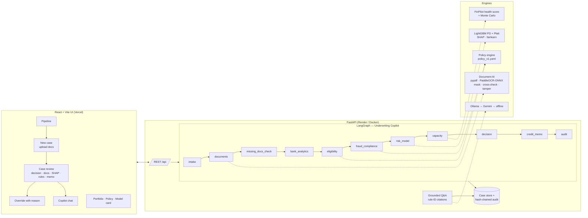

<div align="center">

# ◢ FinPilot HomeLoan

### Explainable mortgage underwriting in minutes — Home Loans & Loans Against Property

**Team DoubleStack** (PCCoE Pune) ·
Hero Housing Fintech Challenge (E-Cell IIT Bombay × Hero Housing Finance) · **Problem Statement 2**

`FastAPI` · `LangGraph` · `LightGBM + SHAP` · `fairlearn` · `PaddleOCR (ONNX)` · `React + Vite + Tailwind` · `MIT`

**Live demo:** _LIVE_URL_ · **Video:** [`submission/demo.mp4`](submission/demo.mp4) · **Deck:** [`submission/deck.pptx`](submission/deck.pptx)

</div>

> **Disclaimer.** FinPilot HomeLoan is *decision support for underwriters*. Final credit decisions follow the
> lender's board-approved credit policy and applicable RBI regulations. Every applicant in this repository is
> **synthetic**; no real personal data is used anywhere.

---

## 1. Problem

Underwriting a home loan in India still takes **3–7 days**. Credit teams:
- re-key PAN, Aadhaar, salary slips, Form 16/ITR, 6–12 months of bank statements and property papers;
- compute FOIR, LTV and age-at-maturity by hand;
- catch forged slips and inflated income mostly by chance.

PS2 asks for a *fully automated, regulator-compliant underwriting engine* that does the following:
- integrates data sources;
- automates eligibility, fraud detection, risk scoring, document verification and compliance checks;
- gives an instant credit decision.

## 2. Solution

**Upload documents → automated checks → explainable decision with conditions → underwriter review → sanction letter draft.**

| Capability | What FinPilot HomeLoan does |
|---|---|
| **Document intake & verification** | Classifies PAN, Aadhaar, salary slips, Form 16, ITR-V, bank statements, sale deed and valuation report. Reads the PDF text layer, and runs PaddleOCR models (RapidOCR / ONNX) on scans. PAN and Aadhaar are **masked at ingestion**: Aadhaar keeps the last 4 digits only. |
| **Cross-document consistency** | Checks name, DOB, address and employer across documents, and salary slip net pay against bank salary credits. |
| **Tampering heuristics** | PDF producer/creator (e.g. iLovePDF/Photoshop), modified-after-creation, font anomalies on figures, round-number patterns, duplicate statements. |
| **Bank-statement analytics** | Average monthly balance, salary regularity, detected EMIs, bounces, cash-deposit spikes, gambling/crypto merchants. |
| **Eligibility (Indian practice)** | FOIR cap by income band, **RBI LTV slabs** (≤₹30L 90%, ₹30–75L 80%, >₹75L 75%), age at maturity, max eligible loan and EMI, tenure options, LAP LTV and end-use rules. All thresholds live in [`policy_v1.yaml`](backend/app/policy/policy_v1.yaml). |
| **Fraud & compliance** | Synthetic negative/PEP/sanctions list, income-inflation detection, KYC completeness, CERSAI/encumbrance placeholder, LAP prohibited end use, and an audit trail of every rule fired. |
| **Risk scoring** | LightGBM PD with monotone constraints and Platt calibration. Gives a 300–900 score and grade A–E, **SHAP reasons in plain English**, and a fairlearn audit across gender and age bands. |
| **Repayment capacity** | Reuses **our FinPilot** 5-pillar health score and bootstrap Monte Carlo cash-flow forecast (1,000 paths, 24 months after EMI, +200 bps / −15% income stress). |
| **Instant decision** | Approve / Approve-with-conditions / Refer / Decline, with top reasons, conditions (*reduce to ₹X*, *add co-applicant earning ₹Y*, *increase tenure*), sanction amount and EMI. Ready in seconds. |
| **Human override** | Full override with mandatory reason, underwriter name and amount, logged in a SHA-256 hash-chained audit trail. |
| **Underwriting Copilot (agentic)** | A LangGraph graph orchestrates the checks, requests missing documents, writes the credit memo and answers underwriter questions **grounded only in case data and policy, citing rule IDs**. Uses local Ollama, or Gemini via an optional env key, or an offline grounded engine, so **no paid key is needed**. |
| **Reports** | Credit memo, sanction-letter draft with a KFS-style summary (rate, EMI, fees, APR), and a written-reasons rejection letter (Fair Practices Code). |
| **UI** | Case pipeline dashboard, case detail with document viewer, extracted fields and flags, decision card, SHAP chart, rules fired, memo, Copilot, portfolio analytics, policy and model card. Dark and light modes. Design language from FinPilot ([DESIGN.md](DESIGN.md)). |

## 3. Architecture



### Data flow
1. **Intake.** The RM submits the application form and documents; a persona pack loads in one click.
2. **Documents.** Each file is classified and text is extracted (PDF text layer or OCR). Fields are parsed and PII is
   masked immediately. Cross-checks and tamper heuristics produce `Flag`s, and missing documents are listed.
3. **Bank analytics.** Transactions are categorised (salary, EMI, bounce, cash, high-risk merchant), then aggregated monthly.
4. **Eligibility.** Assessed income is the minimum of declared income, slip net pay and bank salary credit; for
   self-employed borrowers it is ITR income with a haircut. FOIR and LTV caps come from the policy, and the max loan is
   min(FOIR-based, LTV-based, product max).
5. **Fraud and compliance.** These rules emit `RuleHit`s (rule ID, outcome, effect, evidence, regulatory reference).
6. **Risk model.** The PD gets SHAP reasons; **capacity** is a Monte Carlo of the post-EMI buffer.
7. **Decision.** The hybrid follows strict precedence: policy DECLINE > REFER > CONDITIONS > APPROVE. A model grade E
   on a clean file becomes **REFER** (human oversight), so the model never auto-declines.
8. **Memo, sanction draft and audit.** All are persisted. The underwriter can then override, ask the Copilot, or print the memo.

## 4. Policy & compliance approach

- **Versioned policy-as-code.** [`backend/app/policy/policy_v1.yaml`](backend/app/policy/policy_v1.yaml) holds every
  threshold and the rule catalogue (45 rule IDs), each mapped to a regulatory reference. Decisions record the policy version.
- **LTV.** *Reserve Bank of India (Housing Finance Companies) Directions, 2025* (RBI/DoR/2025-26/365,
  DoR.FIN.REC.284/03-10-119/2025-26, 28-Nov-2025), para 58:
  - caps are 90% (≤ ₹30 lakh), 80% (₹30–75 lakh) and 75% (> ₹75 lakh);
  - LTV is measured on realisable value, excluding stamp duty and registration (except units ≤ ₹10 lakh);
  - banks have the same slabs under RBI's Oct-2020 risk-weight circular.
- **LAP.** RBI sets no regulatory LTV for LAP, so the internal caps (65% residential, 55% commercial, 50% plot) and an
  allowed/prohibited end-use list are policy, clearly marked as such.
- **Fair Practices Code.** Rejections carry written reasons with rule IDs, and the sanction letter carries a KFS-style
  all-in-cost summary (RBI KFS circular, Apr-2024).
- **KYC / AML.** PAN and Aadhaar OVD checks, PEP/sanctions screening with enhanced due diligence (refer), cash-deposit
  monitoring (PMLA), and a CERSAI search placeholder before mortgage creation.
- **Privacy.** Aadhaar is masked to its last 4 digits and PAN masked at ingestion (Aadhaar Act s.29, DPDP Act 2023
  data minimisation). Tests scan every API payload for unmasked numbers.
- **Explainability and human oversight** (RBI FREE-AI, 2025):
  - every rule fired, model score and SHAP reason is shown;
  - the Copilot cites rule IDs, and answers that cite a rule ID which doesn't exist are rejected;
  - underwriters can override anything, with a mandatory reason;
  - a hash-chained audit trail is verifiable at `GET /api/cases/{id}/audit/verify`.

## 5. Model card (summary)

Full card: [docs/MODEL_CARD.md](docs/MODEL_CARD.md).

| | |
|---|---|
| Model | LightGBM (monotone constraints) + Platt calibration, 18 features, `lightgbm-pd-v1` |
| Training data | **Synthetic** Indian mortgage borrowers (60k rows, documented generator). Kaggle Home Credit needs a login, so the method is also benchmarked on public OpenML data. |
| Test (synthetic, n = 12,000) | AUC **0.834** · Gini 0.668 · KS **0.534** · Brier 0.033 · ECE 0.003 |
| Public benchmark | UCI Taiwan credit default (30k): AUC **0.778**, KS 0.427 · German credit-g: AUC 0.790 ± 0.028 |
| Fairness (approve = PD < 5%) | Gender approval-rate gap 0.011 (ratio 0.986) · age-band gap 0.028 (ratio 0.965) |
| Explanations | Top-5 SHAP reasons per case in plain language |
| Governance | Policy rules dominate; a model DECLINE becomes REFER; gender is never a feature |

## 6. Run it

### One command (Docker)
```bash
docker compose up --build
```
The UI is served on http://localhost:8080 and the API docs on http://localhost:8000/docs. 12 personas are preloaded.

### Without Docker (≤ 5 commands)
```bash
python -m venv .venv && . .venv/bin/activate && pip install -r backend/requirements.txt
```
```bash
cd backend && uvicorn app.main:app --port 8000 &
```
```bash
cd frontend && npm install && npm run dev
```
Then open http://localhost:5173. Optional extras:
- OCR for scanned images: `pip install -r backend/requirements-ocr.txt`.
- Local LLM: `ollama pull llama3.2:3b` (set `OLLAMA_HOST`), or set `GEMINI_API_KEY`. Without either, the Copilot uses
  its offline grounded engine.

### Tests & checks
```bash
cd backend && python -m pytest -q && ruff check app && mypy app
```
```bash
cd frontend && npm run lint && npm run build
```
```bash
cd e2e && npx playwright test
```
Results are recorded in [docs/QA.md](docs/QA.md).

### Regenerate data and model
```bash
cd backend && python scripts/generate_personas.py && python scripts/train_model.py
```

## 7. Synthetic personas

There are 12 fictitious applicants in `data/personas/`. Each has an application form, generated PDF/PNG documents and
the expected outcome. They cover salaried, self-employed, LAP, co-applicant, FOIR breach, borderline refer, a
forged-salary-slip fraud, an over-age/over-LTV decline, LAP with a prohibited end use plus gambling spends, a PEP
match and a first-home buyer over the LTV slab. See [`submission/persona_results.json`](submission/persona_results.json)
for engine outcome vs expected.

## 8. Limitations

- The model is trained on synthetic data. PD levels reflect generator assumptions and must be re-trained and
  validated on the lender's booked portfolio before use.
- Bureau, CERSAI, CKYC and Account Aggregator are **placeholders**: bureau scores are synthetic inputs and the CERSAI
  check reads the encumbrance field on the documents.
- OCR is tuned for generated documents. Real-world scans (skew, stamps, regional languages) need more training data.
- Tampering heuristics flag files for review. They are not forensic proof.
- The case store is a single-node JSON/in-memory store. Production would use Postgres with row-level security.
- The FOIR bands, LAP LTV and rate grid are illustrative internal policy, not Hero Housing Finance's actual policy.

## 9. Credits

- **FinPilot** (our own project): 5-pillar financial health score and bootstrap Monte Carlo cash-flow forecast,
  reused for repayment capacity, and the full UI design language.
- Open source: [LightGBM](https://github.com/lightgbm-org/LightGBM), [SHAP](https://github.com/shap/shap),
  [fairlearn](https://github.com/fairlearn/fairlearn), [LangGraph](https://github.com/langchain-ai/langgraph),
  [PaddleOCR](https://github.com/PaddlePaddle/PaddleOCR) via [RapidOCR](https://github.com/RapidAI/RapidOCR),
  [docTR](https://github.com/mindee/doctr) (optional engine), [Ollama](https://github.com/ollama/ollama),
  FastAPI, React, Vite, Tailwind, Recharts, [Piper TTS](https://github.com/OHF-Voice/piper1-gpl) (video voiceover).
- Reference designs studied:
  - [loansight-ai](https://github.com/adityaa-nikam/loansight-ai): Indian OCR + FOIR + RAG
  - [agentic-los](https://github.com/leduykhuong-daniel/agentic-los): LangGraph LOS
  - [AgentiFi](https://github.com/riya-dumbare/AgentiFi): adversarial verification
  - [ai-loan-underwriting-simulator](https://github.com/initPM/ai-loan-underwriting-simulator): human-review handoff
  - [bank-statement-analyzer](https://github.com/SDOS-2026/bank-statement-analyzer)

Licensed under the [MIT License](LICENSE).
