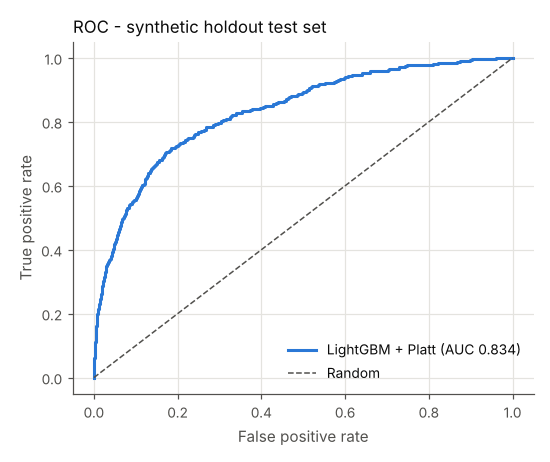
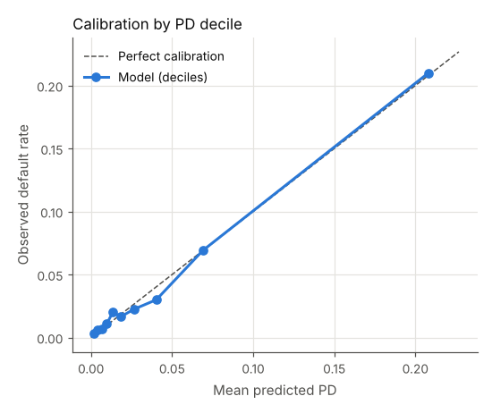
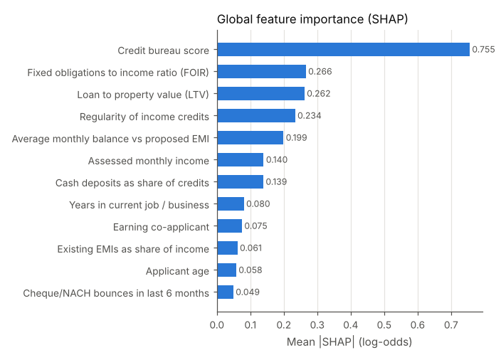
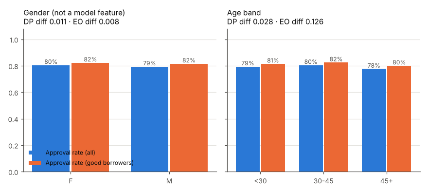

# Model card: FinPilot HomeLoan PD model (`lightgbm-pd-v1`)

| | |
|---|---|
| Model version | `lightgbm-pd-v1+5593a32d` (suffix = first 8 hex of SHA-256 of `model.txt`) |
| Type | Binary classifier for probability of default (PD), LightGBM gradient-boosted trees with monotone constraints, then Platt calibration |
| Output | Calibrated PD, a 300-900 score, grade A-E and band (from `policy_v1.yaml → risk.pd_bands`), and the top 5 SHAP reasons in plain language |
| Code | `backend/app/ml/features.py`, `backend/app/ml/scorer.py`, `backend/app/ml/synthetic.py`, `backend/scripts/train_model.py` |
| Artifacts | `backend/app/ml/artifacts/model.txt` (LightGBM text, ~400 KB), `calibrator.json` (Platt a, b: JSON, no pickle), `metrics.json` |
| Re-train | `cd backend && python scripts/train_model.py` (deterministic, ~10 s on CPU, seed 42) |
| Owner | Credit Risk Analytics (demo). Prototype built for the Hero Housing Fintech Challenge, PS2 |

> **Important:** the production model is trained on **SYNTHETIC data**. No real borrower data was used.
> Its PD levels reflect only the documented generative assumptions. Before any real use it must be re-trained and
> validated on the lender's own booked portfolio, with performance windows of at least 12 months.

## 1. Intended use

- **Use it for:** decision support in home-loan and LAP underwriting. The PD and grade are one input to the hybrid
  decision in `app/engine/decision.py`. **Policy rules always take precedence over the model.** A hard-rule
  DECLINE cannot be overturned by a low PD. When the model alone says DECLINE (grade E) on an otherwise clean file,
  the outcome becomes **REFER** to a human underwriter (`risk.model_decline_becomes_refer: true`).
- **Grades also drive pricing:** the grade sets the rate spread (`pricing.grade_spread`).
- **Do not use it for:**
  - fully automated rejection;
  - non-mortgage products;
  - borrowers or segments far outside the training ranges (for example, loans above ₹20 Cr or NRI income);
  - any decision based on gender, religion, caste or other protected attributes.
- **Users:** credit underwriters and RMs, through the FinPilot HomeLoan case screen, which shows the PD, grade,
  score and reasons for every case.

## 2. Data

### 2.1 Training data: synthetic Indian mortgage borrowers

The training data comes from `app/ml/synthetic.py`: 60,000 rows, seed 42, with a portfolio default rate of 3.95%.
The module docstring documents the full generative process. In summary:

- **Segment mix:**
  - city tier 1/2/3 at 45/35/20%
  - 25% LAP
  - self-employed share of 30% for HL and 65% for LAP
  - 28% women applicants
- **Age:** by employment type.
- **Income:** monthly income is log-normal, with medians of ₹95k / ₹65k / ₹45k by city tier. Self-employed income
  is about 10% higher with wider spread. Women's income is ×0.92, reflecting the observed pay gap. 30-45% of
  applicants have an earning co-applicant.
- **Bureau score:** 745 + 50·z, where z is a latent credit quality.
- **Obligations:** existing EMI ratio and proposed-EMI share give FOIR, with some files in a tail above policy caps.
  Tenure is capped by retirement age. Loan amounts come from the EMI at 8.5% (HL) or 10% (LAP). LTV follows a beta
  distribution by product.
- **Bank-statement behaviour:** bounces, AMB/EMI, income regularity, cash-deposit share and betting/crypto spend,
  all correlated with z.
- **Default:** a Bernoulli draw from a logistic function of the risk drivers. The function has hinges (FOIR above
  45% and 65%, LTV above 85%), an unobserved shock (σ = 0.6) and a small negative term for women. That term mirrors
  bureau studies reporting lower delinquency among Indian women borrowers. The intercept is solved by bisection
  for a 4% default rate.
- **Gender is generated only for fairness testing.** It is not a model feature.
- **Splits (stratified):** 30,600 train, 5,400 early-stopping, 12,000 calibration, 12,000 held-out test.

### 2.2 External benchmark: public data, method only

The same recipe (LightGBM, early stopping, Platt calibration on a separate split) runs on public credit datasets.
They are downloaded without authentication from OpenML. These are **not mortgage data**. They show only that the
method performs at literature level on real defaults.

| Dataset | Rows | Default rate | AUC | KS | Brier | Logistic baseline AUC |
|---|---|---|---|---|---|---|
| UCI "Default of credit card clients" (Taiwan 2005, OpenML 42477) | 30,000 | 22.1% | **0.778** | 0.427 | 0.135 | 0.709 |
| Statlog German credit (OpenML 31), 5-fold CV | 1,000 | 30.0% | **0.790 ± 0.028** | 0.484 | n/a | n/a |

Published results on the Taiwan set are typically AUC 0.77-0.79, and 0.75-0.80 on German credit, so the method
performs at expected levels. On real behavioural data, gradient boosting clearly beats a linear model:
+0.07 AUC on the Taiwan set.

On the Taiwan data with an "approve the lowest-PD 80%" rule:
- the demographic-parity difference by sex is 0.025;
- the equalized-odds difference by sex is 0.020.

## 3. Features (18)

| Feature | Meaning (plain English) | Derived from | Monotone constraint |
|---|---|---|---|
| `bureau_score` | Credit bureau score | `form.bureau_score` (720 if no pull) | ↓ risk |
| `foir` | Fixed obligations (incl. proposed EMI) / income | `eligibility.foir_actual` | ↑ |
| `ltv` | Loan / property value | `eligibility.ltv_actual` | ↑ |
| `monthly_income` | Assessed monthly income incl. co-applicant | `eligibility.assessed_income` | ↓ |
| `loan_to_income` | Loan / annual income | requested amount / (income × 12) | ↑ |
| `existing_emi_to_income` | Existing EMIs / income | `eligibility.existing_obligations` | ↑ |
| `bounces_6m` | Cheque/NACH bounces, scaled to 6 months | `bank.bounces` | ↑ |
| `amb_to_emi` | Average monthly balance / proposed EMI | `bank.avg_monthly_balance / eligibility.requested_emi` | ↓ |
| `income_regularity` | Salary regularity (salaried) or 1 − CV of monthly credits × coverage (self-employed) | `bank.salary_regularity` / `bank.monthly` | ↓ |
| `cash_deposit_share` | Cash deposits / total credits | `bundle.transactions` (category `CASH_DEPOSIT` or "cash" description) | ↑ |
| `high_risk_spend_share` | Betting/crypto merchant spend / debits | `bank.high_risk_merchants` | ↑ |
| `years_in_job` | Job tenure / business vintage | `form.years_in_job` | ↓ |
| `age` | Applicant age | `form.dob` / `bundle.identity.dob` (35 if unknown) | none |
| `tenure_months` | Requested tenure | `form.tenure_months` | none |
| `is_self_employed`, `is_lap`, `has_co_applicant` | Segment flags | form | ↑, ↑, ↓ |
| `city_tier` | 1 metro … 3 smaller town | `form.property_city` / `form.city` | ↑ |

When bank evidence is missing, the defaults are neutral to conservative so that a thin file never scores better than
an average file:
- AMB/EMI of 1.0
- regularity of 0.80
- cash-deposit share of 0.10
- bureau score of 720

The **monotone constraints** guarantee directional behaviour. For example, a higher FOIR can never lower PD and a
higher bureau score can never raise it. This makes reasons consistent and auditable, and unit tests check it.

## 4. Performance (synthetic held-out test set, n = 12,000)

| Metric | Value |
|---|---|
| AUC | **0.834** |
| Gini | 0.668 |
| KS | 0.534 |
| Brier score | 0.0327 |
| Log-loss | 0.131 |
| Expected calibration error (deciles) | 0.0029 |
| Mean PD vs observed default rate | 3.98% vs 3.95% |

**Context and honesty notes:**
- **Ceiling:** an oracle that knows the generator's true PD reaches AUC 0.863. The gap is the unobserved shock,
  which no model can see.
- **Baselines:** on this synthetic data, a logistic regression reaches AUC 0.838. The built-in fallback scorecard,
  which mirrors the generator's functional form, reaches 0.840. Both slightly exceed the GBM. This is expected
  because the generator is additive in log-odds by construction. On real behavioural data (the Taiwan benchmark),
  the GBM wins by 0.07 AUC.
- **Model choice:** we keep LightGBM for three reasons. It is robust to the non-linearities and interactions present
  in real portfolios. It produces exact TreeSHAP explanations. Its monotone constraints make it as auditable as a
  scorecard.
- **Re-check on real data:** the choice between GBM and scorecard must be revisited on the lender's real data.



### 4.1 Calibration

Platt scaling is fitted on the 12,000-row calibration split: pd = σ(0.977 · raw + (−0.077)). Raw LightGBM output was
already well calibrated: Brier 0.03273 and ECE 0.0035 before scaling. Isotonic regression was also evaluated, with
Brier 0.03275 and ECE 0.0053. We chose Platt because:
- it is strictly monotone, so it never creates ties or reverses SHAP direction;
- it has only 2 parameters, stored in JSON;
- it rescales SHAP log-odds exactly (the reasons are multiplied by *a*).

| PD decile | Mean predicted PD | Observed default rate |
|---|---|---|
| 1 | 0.19% | 0.33% |
| 2 | 0.42% | 0.58% |
| 3 | 0.67% | 0.67% |
| 4 | 0.97% | 1.08% |
| 5 | 1.34% | 2.00% |
| 6 | 1.85% | 1.67% |
| 7 | 2.65% | 2.25% |
| 8 | 4.03% | 3.00% |
| 9 | 6.90% | 6.92% |
| 10 | 20.8% | 21.0% |



### 4.2 PD bands, from `policy_v1.yaml`

| Grade | Band | PD range | Share of test | Observed DR | Mean PD | Model-only action |
|---|---|---|---|---|---|---|
| A | Low | ≤ 2% | 57.4% | 1.06% | 0.85% | APPROVE |
| B | Moderate | 2-5% | 22.3% | 2.40% | 3.17% | APPROVE |
| C | Elevated | 5-10% | 10.9% | 6.98% | 6.99% | APPROVE_WITH_CONDITIONS |
| D | High | 10-20% | 5.8% | 14.0% | 13.9% | REFER |
| E | Very high | > 20% | 3.7% | 33.8% | 33.2% | DECLINE → REFER (human) |

Observed default rates increase monotonically from grade to grade, and each band's observed default rate falls
inside its PD range.

### 4.3 Score scale

score = 650 + 50 · log₂(odds_good / 19), clipped to 300-900:
- PD 5% scores 650;
- every 50 points doubles the odds of good;
- PD 1% scores about 769;
- PD 20% scores about 538.

## 5. Explainability

**Global importance** (mean |SHAP| in calibrated log-odds):
- bureau score: 0.755
- FOIR: 0.266
- LTV: 0.262
- income regularity: 0.234
- AMB/EMI: 0.199
- income: 0.140
- cash-deposit share: 0.139
- every other feature: below 0.09



**Per-case reasons:**
- `shap.TreeExplainer` (exact TreeSHAP) computes the reasons on the booster. If shap is unavailable, the scorer
  falls back to LightGBM's native `pred_contrib`, which gives the same values.
- Values are multiplied by the Platt slope, so they read as calibrated log-odds; `+` means the feature increases
  risk.
- The top 5 by |impact| are converted to plain language, for example:
  - "High fixed-obligation-to-income ratio (62%) increased risk"
  - "Weak credit bureau score (660) increased risk"
  - "Healthy average bank balance relative to the proposed EMI (3.2x EMI) reduced risk"
- Every reason carries the feature, its label, the display value and the numeric impact. The case audit trail
  stores them with the model version. This supports the FPC requirement to give written reasons for rejection.

## 6. Fairness (fairlearn `MetricFrame`, synthetic test set)

The model-only approval rule is PD < 5% (grades A-B). A "positive" outcome is a good borrower (no default):
- TPR is the approval rate among good borrowers (equal opportunity);
- FPR is the approval rate among borrowers who later defaulted.

| Group | n | Approval rate | TPR | FPR | Observed DR | Mean PD | AUC |
|---|---|---|---|---|---|---|---|
| Women | 3,380 | 80.5% | 82.3% | 28.3% | 3.34% | 3.94% | 0.846 |
| Men | 8,620 | 79.4% | 81.6% | 29.1% | 4.19% | 4.00% | 0.830 |
| Age < 30 | 1,863 | 79.4% | 81.4% | 19.7% | 3.27% | 4.12% | 0.854 |
| Age 30-45 | 7,654 | 80.4% | 82.4% | 32.2% | 3.97% | 3.85% | 0.828 |
| Age 45+ | 2,483 | 77.6% | 80.0% | 24.8% | 4.39% | 4.29% | 0.839 |

| Attribute | Demographic-parity difference | DP ratio | Equalized-odds difference |
|---|---|---|---|
| Gender | 0.011 | 0.986 | 0.008 |
| Age band | 0.028 | 0.965 | 0.126 |



**Findings:**
- **Gender:** gender is excluded from features. Approval rates differ by about 1 pp, well inside the four-fifths
  rule (ratio 0.99). The model slightly *over-predicts* PD for women: mean 3.94% vs an observed 3.34%. This
  happens because their lower real-world delinquency is not visible in the features. The error is conservative
  rather than discriminatory in approval terms, but it can raise their price through the grade spread. It needs
  monitoring on real data.
- **Age:** the age-band equalized-odds difference of 0.126 comes almost entirely from the **FPR** gap. The model
  approves more 30-45-year-old applicants who later default (32%) than applicants under 30 who later default
  (20%). The equal-opportunity side (TPR) differs by only 2.4 pp. Age is a legitimate underwriting factor because
  of age at maturity and retirement, but young borrowers are slightly over-predicted (mean PD 4.1% vs observed
  3.3%).

**Mitigations in place:**
- Protected attributes are never used as features.
- Monotone constraints prevent spurious patterns.
- Policy rules, not the model, decide eligibility.
- A model DECLINE always becomes a human REFER.
- Every override is logged with a reason.

**If a gap exceeds tolerance on real data** (proposed: DP ratio < 0.8, or an EO difference above 0.10 that persists
after controlling for policy factors), the options are:
- recalibrate per segment, with group-aware calibration done only for monitoring;
- add fairlearn `ThresholdOptimizer` or `ExponentiatedGradient` as a challenger;
- review proxy features, for example city tier and income.

## 7. Limitations

- **Synthetic training data:** the relationships the model learns are the ones we assumed. Absolute PDs, feature
  importance and fairness results are *illustrative* and do not reflect real Indian mortgage performance.
- **Unvalidated assumptions:** the 12-month default definition and the hinge effects in FOIR and LTV are
  assumptions that lender data must validate.
- **Out-of-range inputs:** extreme values such as FOIR > 1.1 or income > ₹14L/month fall outside the training
  ranges. Tree models extrapolate them flat.
- **Fallback scorecard:** when artifacts are missing, a hand-set logistic scorecard with the same output shape is
  used (`model_version = fallback-logistic-scorecard-v1`; synthetic AUC 0.840). It is not a trained model.
- **Upstream accuracy:** bank-statement features are only as good as the document parsing and categorisation.
  Forged statements are handled by the fraud rules, not by the PD model.
- **Not modelled:** macro-economic, property-market and LGD/EAD effects. The PD is application-time only.

## 8. Regulatory alignment and human oversight

- **RBI FREE-AI framework (Aug 2025):** the controls below address explainability, human oversight,
  auditability, fairness testing and model-risk governance:
  - per-decision SHAP reasons;
  - versioned artifacts with a hash;
  - a hash-chained audit trail of every MODEL_SCORED, DECISION and OVERRIDE event;
  - a documented model card and published fairness metrics;
  - deterministic retraining.
- **RBI Fair Practices Code / KFS:** rejection reasons are written in plain language. Pricing grade spreads are
  transparent in `policy_v1.yaml`.
- **DPDP Act 2023 (data minimisation):** the model needs no PAN, Aadhaar, name, gender or other direct identifier.
  Only derived financial ratios are scored.
- **Human oversight:**
  - The model never declines on its own. Grade E becomes REFER.
  - Loans above ₹2 Cr always go to a human.
  - Underwriters can override any outcome, with a mandatory reason, and override rates are tracked in portfolio
    metrics.

## 9. Monitoring plan, for production after real-data re-training

| What | How | Trigger |
|---|---|---|
| Input drift | PSI per feature vs training distribution, monthly | PSI > 0.10 investigate, > 0.25 recalibrate / retrain |
| Score drift | PSI of score and grade mix | PSI > 0.10 |
| Discrimination | AUC / KS / Gini on matured vintages (6, 12 months on book) | AUC drop > 0.03 |
| Calibration | Observed vs predicted by grade; Hosmer-Lemeshow / ECE | Any grade outside its PD band for 2 consecutive quarters |
| Fairness | Approval rate, TPR / FPR, mean PD vs observed DR by gender, age band, city tier | DP ratio < 0.8 or EO diff > 0.10 |
| Overrides | Override rate and direction by grade | > 15% overrides in a grade |
| Governance | Annual independent validation, champion / challenger (GBM vs scorecard), model-risk committee sign-off | Annual |

## 10. Reproducibility

```bash
source /tmp/claude-0/venv/bin/activate     # lightgbm 4.7, shap 0.54, fairlearn 0.15, scikit-learn 1.9
cd backend
python scripts/train_model.py              # writes artifacts + docs/img/model_*.png
python -m pytest tests/test_ml_*.py -q
```

`metrics.json` holds every number in this card. The UI serves it through `GET /api/model-card`, using
`app.ml.scorer.model_info()`.
